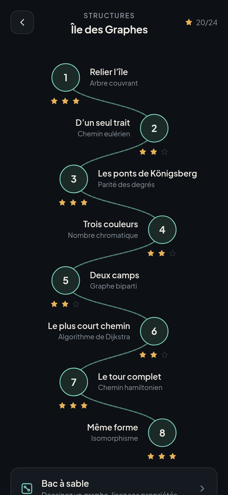
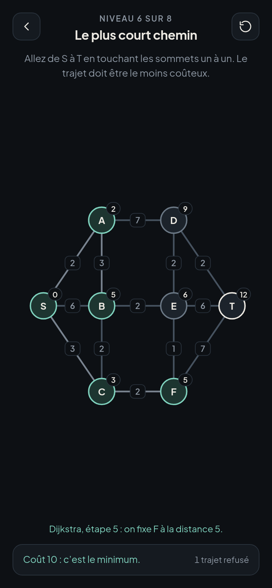
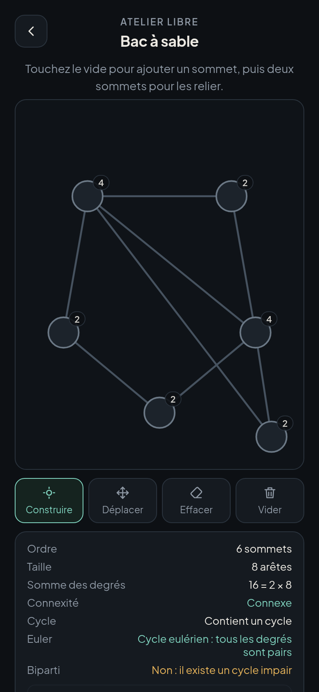

# Structures · Île des Graphes

*Structures* est un jeu éducatif où l’on manipule les objets mathématiques au lieu de les lire. Chaque île du jeu correspond à une structure : on la construit, on la déforme et on vérifie ses propriétés du bout du doigt.

L’Île des Graphes est la première. L’idée est née pendant mon cours de théorie des graphes, à l’Université d’Abomey-Calavi. Les graphes servent ensuite de fil conducteur vers les autres îles.

**Démo : [structures-ile-des-graphes.onrender.com](https://structures-ile-des-graphes.onrender.com)**, pensée pour le téléphone.

<p>
  
  
  
  
</p>

## Les niveaux

Chaque niveau a un objectif d’une ligne. La notion est expliquée après la réussite, et des étoiles récompensent les solutions économes.

| # | Niveau | Notion |
|---|--------|--------|
| 1 | Relier l’île | Arbre couvrant : relier 8 villages avec le moins de routes possible |
| 2 | D’un seul trait | Chemin eulérien : tracer sans lever le doigt |
| 3 | Les ponts de Königsberg | Parité des degrés : reconnaître qu’un tracé est impossible |
| 4 | Trois couleurs | Nombre chromatique : colorier sans que deux voisins se ressemblent |
| 5 | Deux camps | Graphe biparti : répartir les sommets du cube en deux camps |
| 6 | Le plus court chemin | Algorithme de Dijkstra, rejoué étape par étape après la réussite |
| 7 | Le tour complet | Chemin hamiltonien dans le graphe de Petersen |
| 8 | Même forme | Isomorphisme : échanger les sommets pour recouvrir une silhouette |

## Bac à sable

On dessine librement un graphe. Le jeu affiche en direct les degrés, la connexité, la présence d’un cycle, l’existence d’un cycle ou d’un chemin eulérien et la bipartition, avec les deux camps en couleur.

## Îles à venir

- **Île Algébrique** : groupes, tables de Cayley, morphismes
- **Île Topologique** : ouverts, déformations continues
- **Île des Tribus** : tribus et mesure
- **Île Vectorielle** : bases, applications linéaires, valeurs propres

## Technique

- Vite, TypeScript et SVG, sans framework
- Jouable au toucher et à la souris
- Fonctionne hors ligne après le premier chargement (service worker) et s’installe comme une application
- Progression enregistrée dans le navigateur

Chaque niveau est vérifié par un script : force brute pour les chemins eulériens et le plus court chemin, calcul du nombre chromatique, recherche d’un chemin hamiltonien et nombre minimal d’échanges pour l’isomorphisme.

```bash
npm install
npm run dev        # développement
npm run build      # version statique dans dist/
npm run verifier   # vérifie que chaque niveau est résoluble et bien validé
npm run captures   # parcours complet dans Chromium (390×844) et captures
```

`npm run captures` utilise Chrome (`/usr/bin/google-chrome` par défaut, ou la variable `CHROME`).

## Licence

MIT, © 2026 Bienvenu ESSEGNON.
