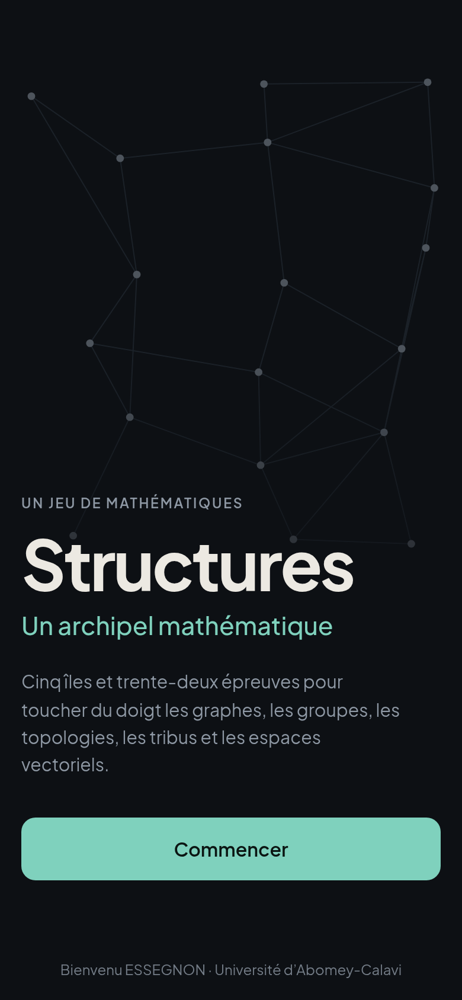
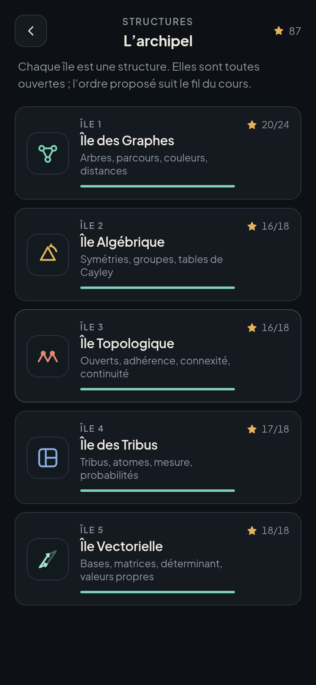
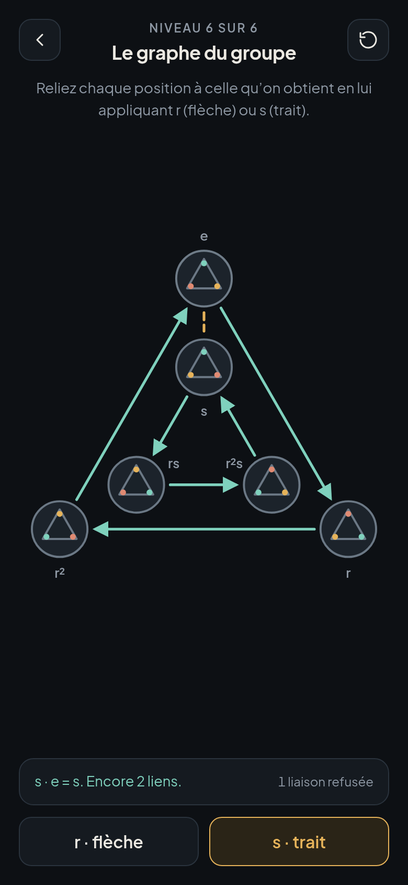
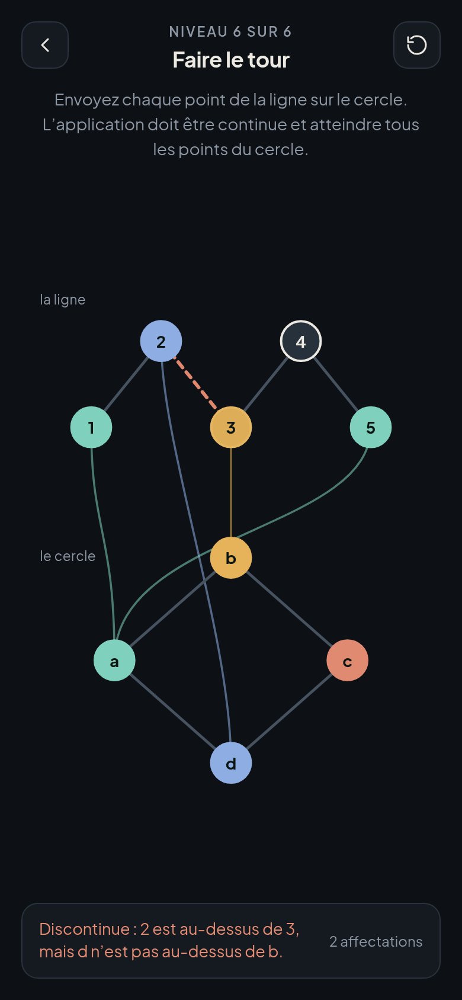
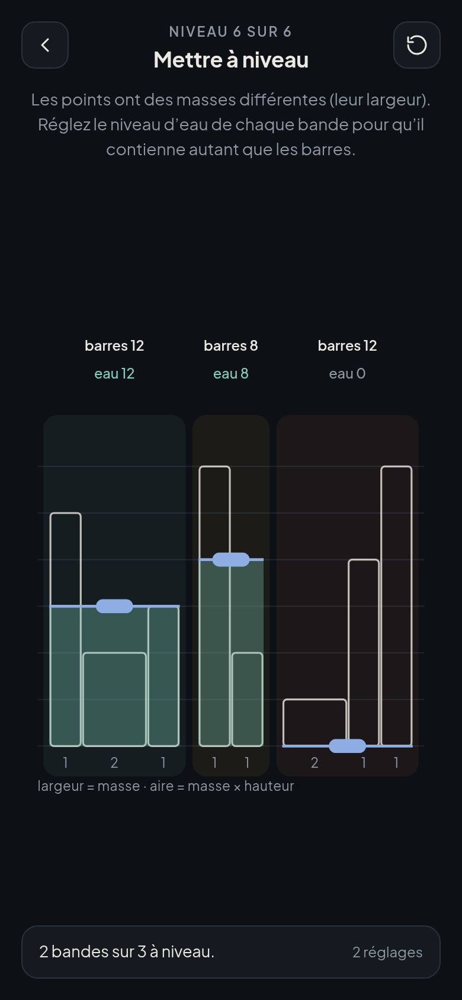
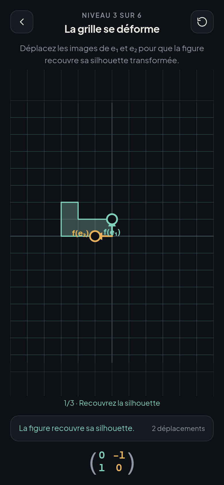

# Structures

*Structures* est un jeu éducatif où l’on manipule les objets mathématiques au lieu de les lire. Chaque île de l’archipel correspond à une structure : on la construit, on la déforme et on vérifie ses propriétés du bout du doigt.

L’idée est née pendant mon cours de théorie des graphes, à l’Université d’Abomey-Calavi. L’Île des Graphes a été la première ; les quatre suivantes reprennent les structures du cursus de licence : groupes, topologies, tribus et espaces vectoriels.

**Démo : [structures-ile-des-graphes.onrender.com](https://structures-ile-des-graphes.onrender.com)**, pensée pour le téléphone.

<p>
  
  
  
</p>
<p>
  
  
  
  
</p>

## Les îles

Chaque niveau a un objectif d’une ligne. La notion est expliquée après la réussite, et des étoiles récompensent les solutions économes. Les îles sont toutes ouvertes ; dans une île, chaque niveau s’ouvre quand le précédent est réussi.

### Île des Graphes

| # | Niveau | Notion |
|---|--------|--------|
| 1 | Relier l’île | Arbre couvrant : relier 8 villages avec le moins de routes possible |
| 2 | D’un seul trait | Chemin eulérien : tracer sans lever le doigt |
| 3 | Les ponts de Königsberg | Parité des degrés : reconnaître qu’un tracé est impossible |
| 4 | Trois couleurs | Nombre chromatique : colorier sans que deux voisins se ressemblent |
| 5 | Deux camps | Graphe biparti : répartir les sommets du cube en deux camps |
| 6 | Le plus court chemin | Algorithme de Dijkstra, rejoué étape par étape après la réussite |
| 7 | Le tour complet | Chemin hamiltonien dans le graphe de Petersen |
| 8 | Même forme | Isomorphisme : échanger les sommets pour recouvrir une silhouette |

### Île Algébrique

| # | Niveau | Notion |
|---|--------|--------|
| 1 | Le triangle tourne | Groupe diédral D₃ : atteindre une position avec la rotation r et la symétrie s |
| 2 | L’horloge | ℤ/12ℤ : trouver les sauts qui allument les douze heures, les générateurs |
| 3 | La table des quarts de tour | Table de Cayley de ℤ/4ℤ, un carré latin à compléter |
| 4 | Un groupe dans le groupe | Sous-groupe d’ordre 4 de D₄, avec les produits qui sortent signalés |
| 5 | Presque un groupe | Associativité : trouver le triplet qui prouve qu’une boucle n’est pas un groupe |
| 6 | Le graphe du groupe | Graphe de Cayley de D₃, qui se révèle être un prisme |

### Île Topologique

| # | Niveau | Notion |
|---|--------|--------|
| 1 | Les ouverts | Topologie engendrée sur {a, b, c, d}, stable par réunion et intersection |
| 2 | Le relief | Ouverts et fermés d’un espace fini, sur la droite de Khalimsky |
| 3 | Bords et intérieur | Adhérence, intérieur et frontière d’une partie |
| 4 | Couper en deux | Connexité : une ligne, un cercle et un huit, coupés avec le moins de points |
| 5 | Déformer les lettres | Homéomorphisme : ranger les lettres selon leurs bouts et embranchements |
| 6 | Faire le tour | Application continue : envoyer une ligne sur un cercle fini, en faisant le tour |

### Île des Tribus

| # | Niveau | Notion |
|---|--------|--------|
| 1 | La tribu engendrée | Tribu : stable par complémentaire et par réunion |
| 2 | Ce que l’on sait | Atomes de la tribu engendrée par deux événements sur un dé |
| 3 | Une fonction aveugle | Fonction mesurable : constante sur chaque atome |
| 4 | Répartir la masse | Mesure additive et inclusion-exclusion, avec des grains |
| 5 | Indépendants | Indépendance de deux événements, et un cas impossible |
| 6 | Mettre à niveau | Espérance conditionnelle, vue comme un niveau d’eau |

### Île Vectorielle

| # | Niveau | Notion |
|---|--------|--------|
| 1 | Pas à pas | Combinaison linéaire : atteindre une cible avec u et v |
| 2 | Revenir au départ | Famille liée : une relation entre trois vecteurs du plan |
| 3 | La grille se déforme | Matrice d’une application linéaire : ses colonnes sont f(e₁) et f(e₂) |
| 4 | Aire signée | Déterminant : aire et orientation du parallélogramme |
| 5 | Écrasé sur une droite | Noyau, image et existence d’une solution à M x = b |
| 6 | Les directions fixes | Vecteurs propres et valeurs propres |

## Bac à sable

Sur l’Île des Graphes, on dessine librement un graphe. Le jeu affiche en direct les degrés, la connexité, la présence d’un cycle, l’existence d’un cycle ou d’un chemin eulérien et la bipartition, avec les deux camps en couleur.

## Technique

- Vite, TypeScript et SVG, sans framework
- Jouable au toucher et à la souris
- Fonctionne hors ligne après le premier chargement (service worker) et s’installe comme une application
- Progression enregistrée dans le navigateur

Chaque niveau est vérifié par un script : force brute pour les chemins eulériens, le plus court chemin, les retraits minimaux et les applications continues ; unicité de la table de Cayley, du sous-groupe et de la répartition des masses ; calcul des familles engendrées, des atomes, des invariants des lettres et des directions propres ; cohérence des seuils d’étoiles avec les solutions optimales.

```bash
npm install
npm run dev        # développement
npm run build      # version statique dans dist/
npm run verifier   # vérifie que chaque niveau est résoluble et bien validé
npm run captures   # parcours complet des cinq îles dans Chromium (390×844) et captures
```

`npm run captures` utilise Chrome (`/usr/bin/google-chrome` par défaut, ou la variable `CHROME`).

## Licence

MIT, © 2026 Bienvenu ESSEGNON.
